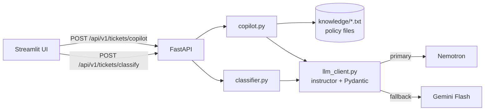

# Nebula AI Support Hub

> Internal AI tools for a customer-support team: a **ticket classifier** that routes incoming requests and an **agent copilot** that drafts replies grounded in company policy. Built as a take-home assignment for an AI Engineer role.


---

## What it does

### 1. AI Router — ticket classification
Takes raw ticket text and returns a validated structured result:

```json
{
  "category": "refund_request",
  "priority": "high",
  "next_step": "route_to_refunds",
  "requires_human_review": true,
  "human_review_reason": "User threatens to contact consumer protection"
}
```

- **6 categories** (`subscription_billing`, `bug_report`, `expert_complaint`, `refund_request`, `general_question`, `other`) — defined by the **action** the ticket needs, not by its wording. "Rude expert + I want my money back" is a refund, because it goes to the finance team.
- **Tone ≠ priority.** CAPS LOCK about a missing avatar button stays low priority; legal threats, double charges and mass outages go high.
- **Human in the loop.** Legal threats, harassment or low confidence set `requires_human_review` with a reason.

### 2. Agent Copilot — reply drafting
For the same ticket it returns a 1–2 sentence summary, **three drafts** (Formal, Empathetic, Short) and the **policy it relied on**. The policy citation is attached from code, not generated, so the model can't invent it. Hard rule in the prompt: never promise a refund unless the policy allows it.

## Architecture



### Reliability

| Failure | Handling | HTTP |
|---|---|---|
| Timeout, rate limit, 5xx | 3 attempts with exponential backoff (`tenacity`), then the **fallback model** | — |
| Both models down | `LLMUnavailableError` | `503` |
| Model returns invalid JSON | `instructor` re-asks with the validation error (2 retries per call) | `422` if still invalid |
| Bad API key | Logged as critical, generic message to the client | `500` |
| Empty ticket | Rejected before any LLM call | `400` |

## Design decisions

- **Streamlit, not React.** It's an internal tool; time-to-market and fast iteration on AI behaviour matter more than a custom UI.
- **Monolith, not microservices.** Both tools share the FastAPI app, schemas and LLM client. They live in separate modules (`services/classifier.py`, `services/copilot.py`), so they can be split later.
- **Keyword retrieval, not a vector DB.** The knowledge base is four short policies — embeddings would add latency without improving recall. `retrieve_knowledge()` is a single function, swappable for a vector store.

Prompt evolution, failure cases and trade-offs are documented in [`docs/task1.md`](docs/task1.md) and [`docs/task2.md`](docs/task2.md).

## Evaluation

`backend/tests/test_classifier_cases.py` runs **13 edge cases** against the live API and writes a report to `docs/test_results.md`: aggression over a trivial issue, sarcasm hiding a real problem, mixed topics, mixed languages, legal threats, phishing, a calm tone with a critical problem, empty and one-word tickets.

```bash
python backend/tests/test_classifier_cases.py   # backend must be running
```

## Quick start

```bash
echo "OPENROUTER_API_KEY=your_key" > .env
docker-compose up --build
```

| Service | URL |
|---|---|
| UI | http://localhost:8501 |
| API docs | http://localhost:8000/docs |

<details>
<summary>Run without Docker</summary>

```bash
python3 -m venv venv && source venv/bin/activate
pip install -r backend/requirements.txt -r frontend/requirements.txt
python -m uvicorn backend.main:app --reload     # terminal 1
streamlit run frontend/app.py                   # terminal 2
```
</details>

Models are configurable via `PRIMARY_MODEL` and `FALLBACK_MODEL` env vars.

## Next steps

- Turn the 13 edge cases into a labelled eval set with accuracy per field, not a manual review report
- Replace keyword retrieval with embeddings once the knowledge base grows
- Tracing and cost monitoring (Langfuse)
